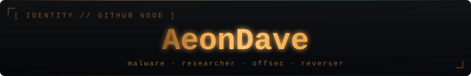
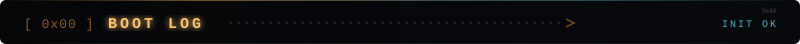
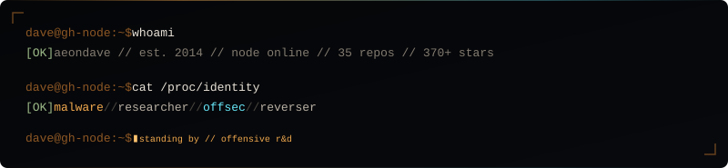
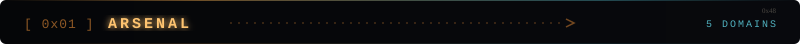
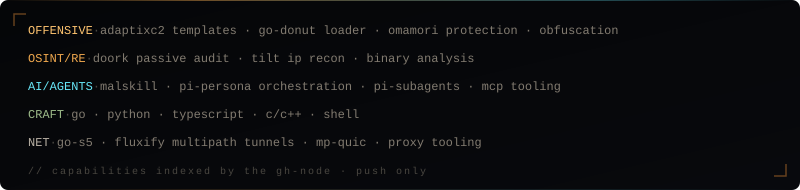
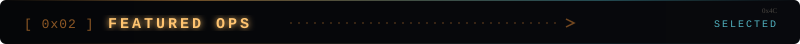
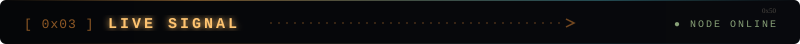

<!-- you inspected the source. respect. there's more of this further down. -->

<div align="center">

</div>

<br>




<br>




<br>



<!--START_SECTION:pinned-->
<table>
<tr>
<td width="50%" valign="top">

**[go-s5](https://github.com/AeonDave/go-s5)** · Go
A minimal, fast, and extensible SOCKS5 lib written in Go.

</td>
<td width="50%" valign="top">

**[malskill](https://github.com/AeonDave/malskill)** · Python
Offensive oriented Skill for agentic AI

</td>
</tr>
<tr>
<td width="50%" valign="top">

**[pi-persona](https://github.com/AeonDave/pi-persona)** · TypeScript
Supervised multi-agent orchestration for Pi

</td>
<td width="50%" valign="top">

**[pi-persona-mind](https://github.com/AeonDave/pi-persona-mind)** · TypeScript
—

</td>
</tr>
</table>
<!--END_SECTION:pinned-->

<br>



<div align="center">


</div>

<br>

<details>
<summary><code>▸ [ DECRYPT ] classified transmission ·· click to resolve</code></summary>
<br>

```
dave@gh-node:~$ openssl enc -d -aes-256-cbc -in signal.enc -pass file:.operator
[OK] ciphertext resolved.

  4d 41 4c 57 41 52 45 20 49 53 20 4a 55 53 54 20   MALWARE IS JUST
  53 4f 46 54 57 41 52 45 20 57 49 54 48 20 4f 50   SOFTWARE WITH OP
  49 4e 49 4f 4e 53 2e 20 49 20 48 4f 4c 44 20 4d   INIONS. I HOLD M
  4f 53 54 20 4f 46 20 54 48 45 4d 2e 00            OST OF THEM.

dave@gh-node:~$ █
```

</details>

<!-- node signature: AEONDAVE // OFFENSIVE R&D // push only -->
